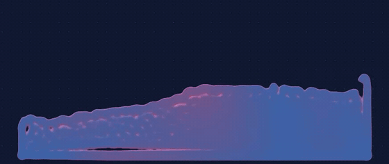
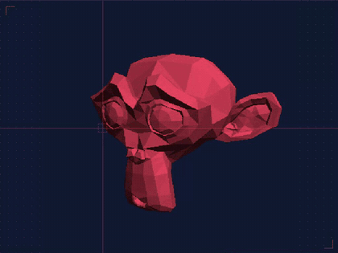
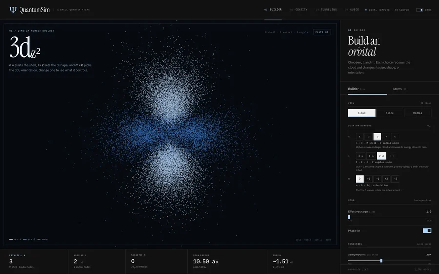
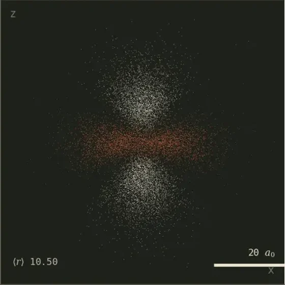
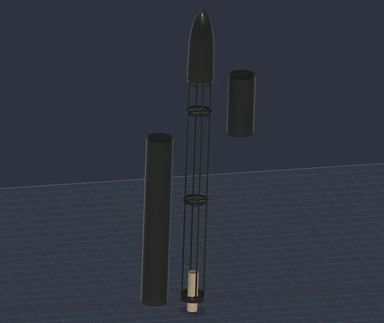
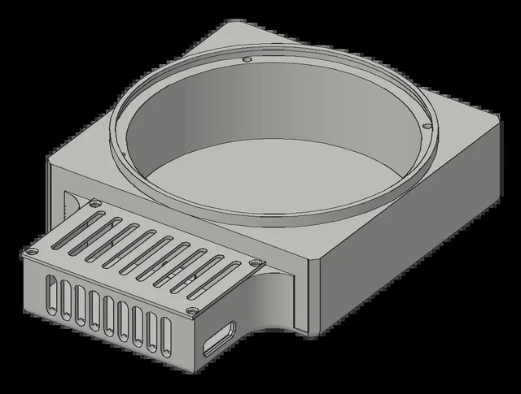
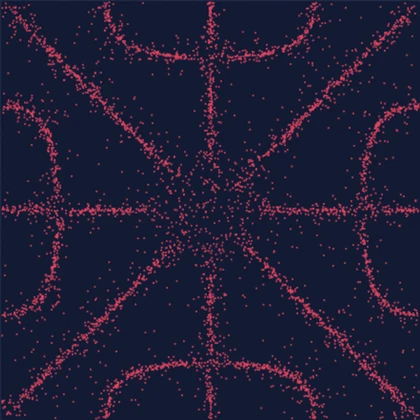

# Jahaan Bhavsar

`Physics` · `Computer Science` · `AI/ML` · `Engineering` · `Mathematics`

Building software, simulations, and systems to understand how things work.

## Simulations and graphics

<table>
  <tr>
    <td width="58%" valign="top">
      
       <b><a href="https://github.com/jahaanb7/Fluid-Simulation">Fluid Simulation</a></b> · C++, OpenGL, WebAssembly
       Smoothed particle hydrodynamics with a 2D and a 3D mode. The same C++ runs natively and in the browser.
    </td>
    <td width="42%" valign="top">
      
       <b><a href="https://github.com/jahaanb7/Rasterix-Software-Rasterizer-">Rasterix</a></b> · Java
       A software rasterizer: projection, barycentric fill and a depth buffer, with no graphics API.
    </td>
  </tr>
  <tr>
    <td valign="top">
      
    </td>
    <td valign="top">
      
       <b><a href="https://github.com/jahaanb7/QuantumSim">QuantumSim</a></b> · JavaScript, Three.js
       Hydrogen orbitals sampled from |ψ|², and wave-packet tunnelling with a split-step Fourier solver.
    </td>
  </tr>
</table>

## Hardware, still on paper

<table>
  <tr>
    <td width="33%" valign="top">
      
       <b><a href="https://github.com/jahaanb7/Orion">Orion</a></b> · KiCad, Fusion 360
       A thrust-vector-controlled model rocket with a custom flight computer. Design only, not built yet.
    </td>
    <td width="33%" valign="top">
      
       <b><a href="https://github.com/jahaanb7/ChladniPlate">Chladni Plate</a></b> · KiCad, Fusion 360
       A plate driven by a subwoofer and a TPA3116 amplifier. Designed and costed, not built yet.
    </td>
    <td width="33%" valign="top">
      
       Sand settling on the nodal lines of mode (3, 5), simulated on an ideal square plate.
    </td>
  </tr>
</table>

[**ATLAS**](https://github.com/jahaanb7/RadioTelescope_ALTAS) · a planned hydrogen-line radio telescope listening for 1420.4 MHz.

## Smaller experiments

| | |
| --- | --- |
| [Particle Simulation](https://github.com/jahaanb7/Science-Simulations) | C++ and OpenGL particles with Velocity Verlet, gravity and elastic collisions |
| [Myelovar](https://github.com/jahaanb7/BioMedizone_Hackathon) | Hackathon pipeline that scores regulatory variants in myeloma cells (research use only) |
| [Buffy](https://github.com/jahaanb7/J.A.R.V.I.S) | Electron and TypeScript desktop assistant; file writes and commands wait for approval |
| [Lorenz Attractor](https://github.com/jahaanb7/Lorenz-Attractor-Simulation) | Notebook on chaos, phase space and the Van der Pol oscillator |
| [Machine Learning Models](https://github.com/jahaanb7/Machine-Learning-Models) | Linear and logistic regression written with NumPy |
