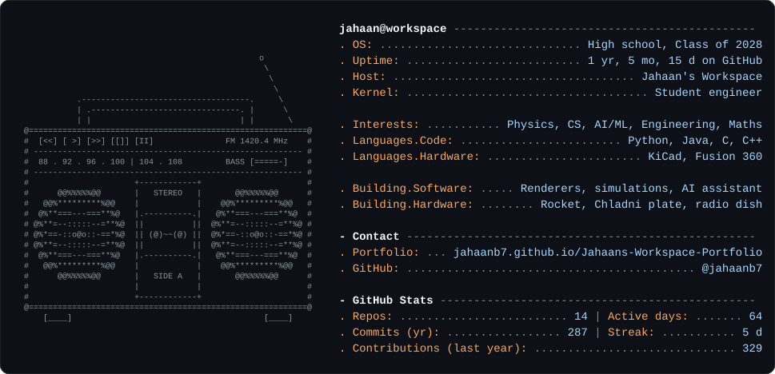
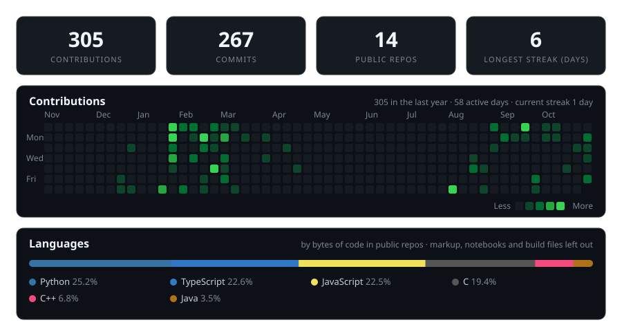

<a href="https://jahaanb7.github.io/Jahaans-Workspace-Portfolio/">
  <picture>
    <source media="(prefers-color-scheme: dark)" srcset="assets/card-dark.svg">
    <source media="(prefers-color-scheme: light)" srcset="assets/card-light.svg">
    
  </picture>
</a>

## [My portfolio ↗](https://jahaanb7.github.io/Jahaans-Workspace-Portfolio/)

## Projects

| | |
| --- | --- |
| [Particle Simulation](https://github.com/jahaanb7/Science-Simulations) | C++ and OpenGL particles with Velocity Verlet, gravity and elastic collisions |
| [Myelovar](https://github.com/jahaanb7/BioMedizone_Hackathon) | Hackathon pipeline that scores regulatory variants in myeloma cells (research use only) |
| [Buffy](https://github.com/jahaanb7/J.A.R.V.I.S) | Electron and TypeScript desktop assistant; file writes and commands wait for approval |
| [Lorenz Attractor](https://github.com/jahaanb7/Lorenz-Attractor-Simulation) | Notebook on chaos, phase space and the Van der Pol oscillator |
| [Machine Learning Models](https://github.com/jahaanb7/Machine-Learning-Models) | Linear and logistic regression written with NumPy |

## Activity

<picture>
  <source media="(prefers-color-scheme: dark)" srcset="assets/stats-dark.svg">
  <source media="(prefers-color-scheme: light)" srcset="assets/stats-light.svg">
  
</picture>

